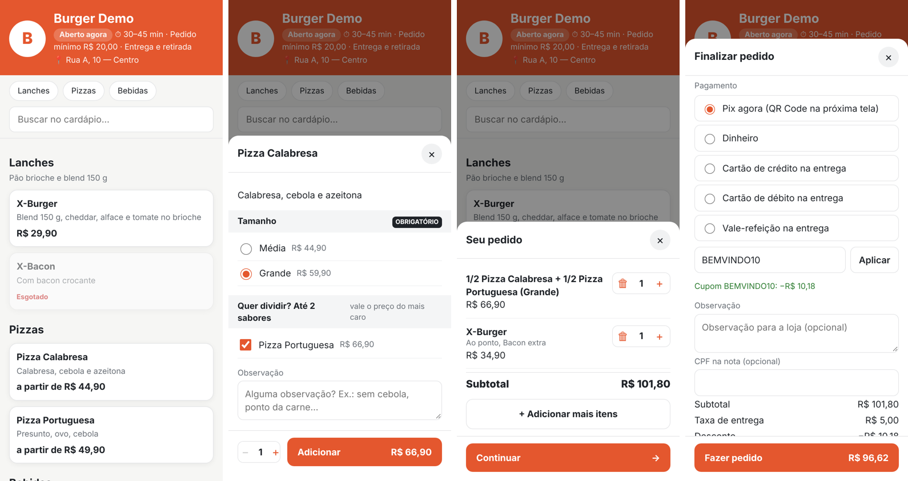
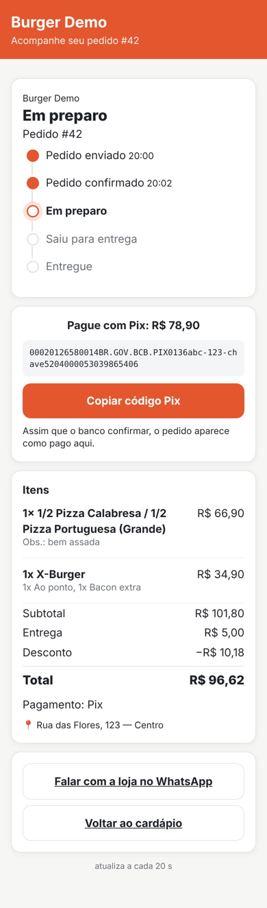

# ApFood

Sistema de gestão e PDV **multiempresa** para restaurantes e hamburguerias, com cardápio digital e sincronização em tempo real. Feito em **Python**.

| Pasta | O que é | Stack |
|---|---|---|
| `backend/` | API REST, WebSocket, **painel web completo** (gestão + PDV no navegador), cardápio digital público | Django 5.2 + DRF + Channels + PostgreSQL + Redis |
| `desktop/` | PDV Windows **opcional** (offline e impressão térmica direta): pedidos online, balcão, delivery, caixa | PySide6 + SQLite local |
| `core/` | Regras compartilhadas: caixa, totais, status do pedido, dinheiro, enums | Python puro |

🖥️ [Painel web](docs/PAINEL.md) · 📐 [Arquitetura](docs/ARQUITETURA.md) · 🗄️ [Banco de dados](docs/BANCO_DE_DADOS.md) · 🔌 [API](docs/API.md) · 🗺️ [Roadmap](docs/ROADMAP.md)

[](https://github.com/julicorlando/apfood/actions/workflows/ci.yml)

## Rodando localmente

Requisitos: Python 3.12+ e Docker.

```bash
python -m venv .venv
source .venv/bin/activate          # Windows: .venv\Scripts\activate
cp .env.example .env               # ajuste DJANGO_SECRET_KEY

docker compose up -d               # PostgreSQL + Redis

cd backend
pip install -r requirements/dev.txt
python manage.py migrate
python manage.py seed_demo         # usuários demo, senha apfood123 (ver tabela abaixo)
python manage.py runserver         # http://localhost:8000/painel/  e  http://localhost:8000/burger-demo/  (cardápio)
```

Usuários criados pelo `seed_demo`, para testar o isolamento entre empresas:

| Login | Papel | Vê |
|---|---|---|
| `master` | MASTER | todas as empresas |
| `admin` | ADMIN da Burger Demo | só a Burger Demo |
| `gerente`, `caixa1` | GERENTE / OPERADOR | só a loja burger-demo |
| `admin.pizza` | ADMIN da Pizza Teste | só a Pizza Teste |

Tudo funciona pelo navegador em `/painel/` ([guia](docs/PAINEL.md)). O PDV desktop é opcional, para trabalhar offline: baixe o **`ApFoodPDV.exe`** gerado pela CI (Actions → Artifacts) ou rode pelo código:

```bash
pip install -e core -e desktop
python -m apfood_pdv
```

Guia completo do PDV (impressoras, atalhos, offline, fiscal × não fiscal): [docs/PDV.md](docs/PDV.md). Integrações e rotinas do servidor: [docs/INTEGRACOES.md](docs/INTEGRACOES.md).

Testes:

```bash
pytest core/tests desktop/tests     # regras puras e PDV (na raiz; interface exige PySide6)
cd backend && pytest                # backend (precisa do PostgreSQL do docker compose)
```

A CI (GitHub Actions) roda tudo isso num PostgreSQL a cada push, valida as migrations e executa o `seed_demo`.

## Status

- [x] **Passo 1** — arquitetura, modelagem do banco, estrutura do projeto, multiempresa
- [x] **Passo 2** — regras de negócio, API, sincronização e tempo real
- [x] **Integrações** — NFC-e (Focus NFe) ou cupom não fiscal, Pix, WhatsApp, iFood, cobrança das empresas
- [x] **Passo 3** — App PC (PDV) com impressão e modo offline
- [x] **Passo 4** — Cardápio digital com acompanhamento em tempo real
- [x] NF-e 55, geocodificação para taxa por raio e atualização automática do PDV

### Cardápio digital (`/<slug-da-loja>/`)




