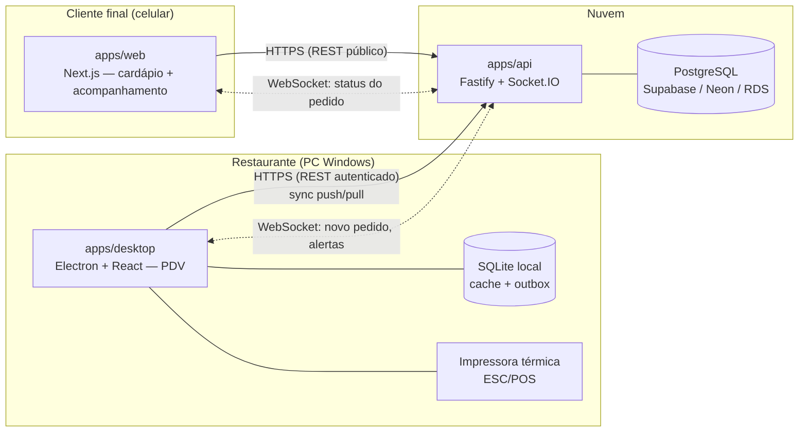
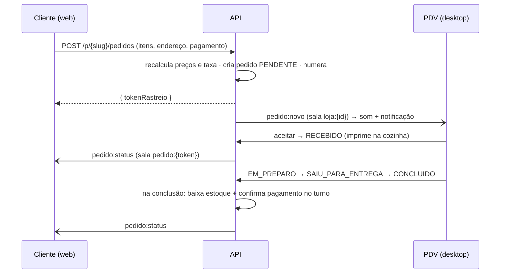

# Arquitetura do ApFood

## 1. Visão geral



Um único **backend próprio** é a fonte da verdade. Web e desktop nunca falam com o banco diretamente — todas as regras críticas (preço, caixa, estoque, transições de status) rodam em transações no servidor.

## 2. Stack escolhida

| Camada | Tecnologia | Por quê |
|---|---|---|
| Monorepo | **pnpm workspaces + Turborepo** | Tipos e regras compartilhados entre os 3 apps; build incremental |
| Linguagem | **TypeScript** em tudo | Um contrato só (zod + tipos) do banco até a tela |
| Banco | **PostgreSQL** (Supabase como hospedagem sugerida) | Relacional, transações ACID para caixa/estoque, agregações para relatórios |
| ORM | **Prisma** | Schema declarativo, migrations versionadas, tipagem forte |
| API | **Fastify** + **zod** | Rápido, leve, ótimo suporte a TS e plugins (JWT, CORS, rate limit) |
| Tempo real | **Socket.IO** (no próprio servidor da API) | Salas por loja e por pedido, reconexão automática com recuperação de estado, fallback para long-polling em redes ruins |
| Desktop | **Electron + electron-vite + React** | Mesmo runtime JS do resto; acesso nativo a impressora (ESC/POS), SQLite (`better-sqlite3`), notificações e auto-update. Tauri exigiria Rust para impressão/SQLite |
| Web | **Next.js (App Router)** | SSR do cardápio (carrega rápido no 4G, bom para compartilhar link), mobile-first |
| Auth | JWT (access curto + refresh) + **argon2id**; PIN para troca rápida de operador | |

### Por que não Supabase Realtime / Firebase direto no cliente?
O realtime "direto do banco" funciona bem para leitura, mas o ApFood tem regras que **não podem** rodar no cliente: recalcular preço do pedido online, baixar estoque atomicamente, calcular o esperado do caixa, validar transições de status. Com a API como única porta de escrita, o realtime vira consequência (a API emite o evento depois do commit). O Supabase continua sendo uma ótima opção de **hospedagem** do PostgreSQL.

## 3. Estrutura do repositório

```
apfood/
├── apps/
│   ├── api/          # Fastify + Socket.IO (Passo 2)
│   ├── desktop/      # Electron PDV (Passo 3)
│   └── web/          # Next.js cardápio digital (Passo 4)
├── packages/
│   ├── database/     # schema Prisma, migrations, seed, client
│   └── shared/       # enums, schemas zod, cálculo de caixa/totais, eventos realtime
├── docs/             # arquitetura, banco, roadmap
├── docker-compose.yml
└── turbo.json
```

## 4. Resiliência offline do PDV

O desktop precisa continuar vendendo no balcão se a internet cair.

1. **IDs gerados no cliente (UUID).** Pedido, turno e movimentação criados offline já nascem com o ID definitivo. Reenviar = upsert idempotente, sem duplicar.
2. **Outbox local (SQLite).** Toda escrita do PDV vira uma linha na `outbox` *antes* de ir à rede. Um worker envia em ordem (`seq`) com backoff exponencial; só marca `enviado_em` após confirmação do servidor.
3. **Cache de leitura.** Catálogo, adicionais, clientes e zonas de entrega ficam em `cache_registros`, atualizados por **pull incremental** (`GET /sync/pull?desde=<updatedAt>`) — por isso toda tabela sincronizável tem `updatedAt` indexado e `deletedAt` (soft delete).
4. **Número do pedido.** O número diário (#001, #002…) é atribuído pelo servidor via `sequencias_pedido`. Offline, o pedido recebe um `codigoLocal` provisório (ex.: `C1-0042`) impresso no cupom; ao sincronizar recebe o número oficial.
5. **O que exige internet:** receber pedidos online (por definição) e fechar caixa de forma definitiva (o fechamento é calculado no servidor; offline o desktop mostra uma prévia com a mesma função `calcularEsperado`).
6. **Conflitos.** Catálogo: o servidor vence (o PDV não edita catálogo offline). Pedidos: cada pedido tem um único "dono" de escrita por vez, e transições de status são validadas pela máquina de estados — uma transição inválida que chegue atrasada é rejeitada e registrada no log.
7. **Reconexão.** Ao reconectar o Socket.IO, o servidor envia `sync:recomendado`; o desktop esvazia a outbox e faz pull, garantindo que nenhum pedido online chegado durante a queda fique de fora.

## 5. Fluxos principais

### Pedido online


### Caixa
- Abrir turno → `turnos_caixa` (1 aberto por operador, garantido por índice parcial).
- Cada pagamento **confirmado** gera uma `movimentacoes_caixa` tipo `VENDA` no turno de quem recebeu.
- Sangria/suprimento/despesa em dinheiro → movimentações do mesmo turno.
- Fechamento: operador informa valores por forma (cega = sem ver o esperado); a API calcula o esperado, grava uma linha em `conferencias_caixa` por forma e a quebra/sobra total no turno.

### Estoque
- Na conclusão (ou no aceite, configurável por loja em `momentoBaixaEstoque`), dentro da mesma transação:
  - produtos com `controlaEstoque` → baixa o próprio produto;
  - produtos com `baixarInsumos` → baixa cada insumo da ficha técnica × quantidade;
  - adicionais com insumo vinculado → baixa o insumo.
- Cada baixa gera linha no kardex (`movimentacoes_estoque`) com saldo anterior/posterior; `pedidos.estoqueBaixado` impede baixa dupla. Cancelamento gera `ESTORNO_VENDA`.
- Se o saldo cruzar o `estoqueMinimo`, a API emite `estoque:alerta-minimo`.

## 6. Segurança
- Rotas públicas (`/p/*`) com rate limit; o cliente nunca envia preço.
- Rotas do PDV exigem JWT; permissões por papel (ADMIN > GERENTE > OPERADOR). Ex.: cancelar pedido concluído, reabrir caixa e ver relatórios financeiros exigem GERENTE+.
- Link de acompanhamento usa `tokenRastreio` aleatório (não o ID nem o número).
- Ações sensíveis vão para `logs_auditoria`.
