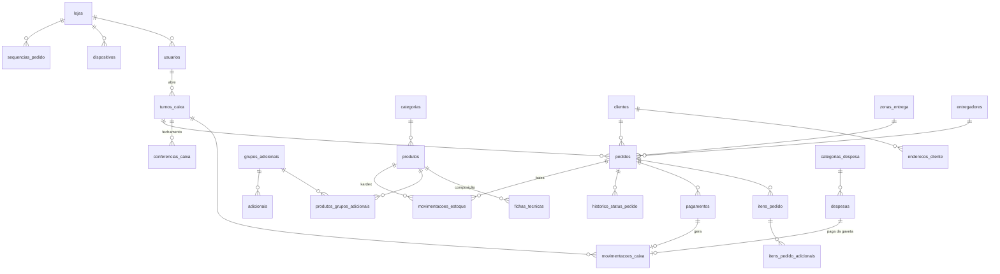

# Modelagem do banco de dados

PostgreSQL, gerado pelos models Django em `backend/apps/*/models.py`. As tabelas têm nomes em português e snake_case (`db_table`).

Convenções de todas as tabelas:

| Coluna | Significado |
|---|---|
| `id` | UUID (pode ser gerado no PDV offline) |
| `criado_em` / `atualizado_em` | timestamps; `atualizado_em` é indexado e serve de cursor de sincronização |
| `excluido_em` | soft delete nos cadastros que o PDV replica |
| `loja_id` | tenant |
| `*_centavos` | dinheiro em centavos (inteiro) |
| quantidades de estoque | `numeric(12,3)` |

## Diagrama

## Tabelas por módulo

### Lojas e acesso
| Tabela | Conteúdo |
|---|---|
| `lojas` | dados, slug público, endereço + lat/long, horários (JSON), pedido mínimo, aceite automático, momento da baixa de estoque |
| `sequencias_pedido` | contador por loja/dia → número do pedido |
| `dispositivos` | PCs com o PDV, hash do token, último sync |
| `usuarios` | login, senha (Argon2), `papel` ADMIN/GERENTE/OPERADOR, PIN, loja |
| `logs_auditoria` | ação, entidade, dados JSON |

### Caixa
| Tabela | Conteúdo |
|---|---|
| `turnos_caixa` | operador, fundo de troco, abertura/fechamento, tipo de conferência (CEGA/DETALHADA), totais esperado/informado, diferença (quebra/sobra) |
| `movimentacoes_caixa` | VENDA, ESTORNO_VENDA, SUPRIMENTO, SANGRIA, DESPESA × forma de pagamento × valor (> 0) |
| `conferencias_caixa` | uma linha por forma de pagamento no fechamento |

### Cardápio e estoque
| Tabela | Conteúdo |
|---|---|
| `categorias` | ordem, ativa |
| `produtos` | VENDA ou INSUMO, preço, custo, `controla_estoque`, `baixar_insumos`, unidade, saldo, mínimo |
| `fichas_tecnicas` | produto → insumo × quantidade |
| `grupos_adicionais` / `adicionais` | mín/máx de seleção; adicional pode consumir insumo |
| `produtos_grupos_adicionais` | quais grupos cada produto oferece |
| `movimentacoes_estoque` | kardex: ENTRADA, SAIDA_VENDA, ESTORNO_VENDA, AJUSTE, PERDA, com saldo anterior/posterior |

### Clientes e entrega
| Tabela | Conteúdo |
|---|---|
| `clientes` | nome, telefone (único por loja, só dígitos) |
| `enderecos_cliente` | vários por cliente, um principal |
| `zonas_entrega` | taxa por BAIRRO ou por faixa de RAIO_KM |
| `entregadores` | motoboys |

### Pedidos
| Tabela | Conteúdo |
|---|---|
| `pedidos` | canal (ONLINE/BALCAO/DELIVERY), atendimento (CONSUMO_LOCAL/RETIRADA/ENTREGA), status, token de rastreio, mesa/senha, endereço (snapshot), valores, turno, atendente, linha do tempo |
| `itens_pedido` | snapshot do nome e preço, quantidade, observação |
| `itens_pedido_adicionais` | snapshot dos adicionais escolhidos |
| `pagamentos` | forma, status, valor, valor recebido, troco, turno em que entrou |
| `historico_status_pedido` | de → para, usuário |

### Financeiro
| Tabela | Conteúdo |
|---|---|
| `categorias_despesa` | Fornecedores, Aluguel, Motoboys... |
| `despesas` | competência, pagamento, forma; se paga da gaveta, vinculada ao turno |

## Regras garantidas pelo banco

Declaradas em `Meta.constraints`, então viram SQL na migration:

- `turno_aberto_por_usuario`: índice único parcial, no máximo 1 turno ABERTO por operador
- `mov_caixa_valor_positivo` e `mov_caixa_gaveta_so_dinheiro`: sangria, suprimento e despesa só em dinheiro
- `pagamento_valor_positivo`, `pagamento_confirmado_tem_data`
- `pedido_numero_unico_dia`, `pedido_entrega_tem_endereco`
- `item_quantidade_positiva`
- `grupo_min_max`, `ficha_nao_recursiva`, `adicional_insumo_com_quantidade`
- `mov_estoque_saida_negativa` / `mov_estoque_entrada_positiva`
- `um_endereco_principal`, `cliente_telefone_unico`, `produto_codigo_unico`

## Como os relatórios saem dessas tabelas

| Relatório | Fonte |
|---|---|
| Faturamento diário/semanal/mensal, ticket médio | `pedidos` CONCLUIDO, `total_centavos` agrupado por `data_referencia` |
| Canais de venda | `pedidos.canal` |
| Mais vendidos / Curva ABC | `itens_pedido` agrupado por `produto_id`, ordenado pelo faturamento acumulado (A ≈ 80%, B ≈ 15%, C ≈ 5%) |
| Fechamentos por operador | `turnos_caixa` + `conferencias_caixa` |
| Fluxo de caixa | entradas: `pagamentos` CONFIRMADO; saídas: `despesas` |
| Estoque mínimo | `produtos` com `controla_estoque` e `estoque_atual <= estoque_minimo` |
