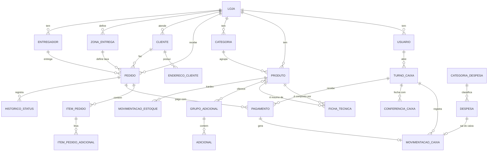

# Modelagem do banco de dados

Fonte da verdade: [`packages/database/prisma/schema.prisma`](../packages/database/prisma/schema.prisma). Restrições extras (índice parcial, CHECKs, trigram): [`extras.sql`](../packages/database/prisma/extras.sql).

## Convenções
- **UUID** em todas as PKs, gerado no cliente quando possível (sync offline idempotente).
- **Dinheiro em centavos** (`Int`). Quantidades de estoque em `Decimal(12,3)`.
- **Snapshots** em itens de pedido (nome e preço) e endereço de entrega — o histórico não muda se o cadastro mudar.
- **Multi-loja** desde o início (`loja_id` nas tabelas raiz) — custa pouco agora e evita uma migração dolorosa depois.
- `updated_at` indexado + `deleted_at` nas tabelas que o desktop sincroniza.

## Diagrama ER (principais relações)

## Tabelas

| Tabela | Finalidade | Campos-chave |
|---|---|---|
| `lojas` | Tenant + configurações (slug público, geolocalização, horários, pedido mínimo, aceite automático, momento da baixa de estoque) | `slug` único |
| `sequencias_pedido` | Contador atômico do número diário do pedido | PK (`loja_id`, `data`) |
| `usuarios` | Login, papel (ADMIN/GERENTE/OPERADOR), senha argon2, PIN | único (`loja_id`, `login`) |
| `dispositivos` | PCs com o PDV instalado; token e último sync | |
| `logs_auditoria` | Ações sensíveis (cancelamentos, alteração de preço, reabertura de caixa) | |
| `turnos_caixa` | Turno por operador: fundo de troco, abertura, fechamento, totais esperado/informado/diferença | índice parcial: 1 ABERTO por usuário |
| `movimentacoes_caixa` | Livro-razão do turno: VENDA, ESTORNO_VENDA, SUPRIMENTO, SANGRIA, DESPESA — por forma de pagamento | `pagamento_id`/`despesa_id` únicos |
| `conferencias_caixa` | Fechamento por forma: esperado × informado × diferença | único (`turno_id`, `forma`) |
| `categorias` | Seções do cardápio | |
| `produtos` | Itens de venda **e** insumos (`tipo`). Flags `controla_estoque` e `baixar_insumos`, saldo e mínimo | |
| `fichas_tecnicas` | Composição: produto → insumo × quantidade | |
| `grupos_adicionais` | "Ponto da carne" (1..1), "Adicionais" (0..5) | `min_selecao`, `max_selecao` |
| `produtos_grupos_adicionais` | N:N produto ↔ grupo, com ordem | |
| `adicionais` | Opções do grupo, preço, máx. por item, insumo consumido opcional | |
| `clientes` | Cadastro por telefone (auto-preenchimento no delivery) | único (`loja_id`, `telefone`) |
| `enderecos_cliente` | Vários endereços por cliente | |
| `zonas_entrega` | Taxa por bairro ou por raio (km) | |
| `entregadores` | Motoboys | |
| `pedidos` | Canal, tipo de atendimento, status, identificação (nome/senha/mesa), endereço snapshot, valores, turno/atendente/dispositivo, linha do tempo | `token_rastreio` único |
| `itens_pedido` | Snapshot de nome e preço, quantidade, observação | |
| `itens_pedido_adicionais` | Adicionais escolhidos por item | |
| `pagamentos` | Múltiplos por pedido; troco; status; turno em que entrou | |
| `historico_status_pedido` | Auditoria de cada transição | |
| `movimentacoes_estoque` | Kardex: ENTRADA, SAIDA_VENDA, ESTORNO_VENDA, AJUSTE, PERDA, com saldos | |
| `categorias_despesa` / `despesas` | Saídas para o fluxo de caixa | |

## Como os relatórios saem do modelo
- **Faturamento diário/semanal/mensal e por canal:** `pedidos` CONCLUIDO agrupados por `date_trunc(created_at)` e `canal`.
- **Ticket médio:** `SUM(total_centavos) / COUNT(*)` dos concluídos no período.
- **Curva ABC:** `itens_pedido` agrupados por `produto_id`, ordenados por receita, com percentual acumulado (A ≤ 80%, B ≤ 95%, C restante).
- **Fechamentos por operador:** `turnos_caixa` + `conferencias_caixa`.
- **Fluxo de caixa:** entradas = `pagamentos` confirmados; saídas = `despesas` (por competência ou pagamento).
